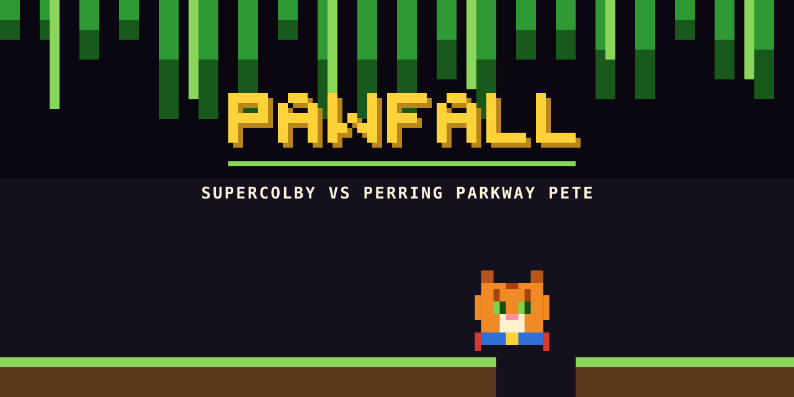

<p align="center"></p>

<p align="center">
<a href="https://bsommers.github.io/pawfall/play/"></a>
<a href="https://bsommers.github.io/pawfall/"></a>


</p>

# PawFall

SuperColby, an orange tabby in a caped C-shield shirt, runs, jumps and vine-swings through a 120-screen jungle to win back 32 treasures from Perring Parkway Pete, a feral red-eyed rat in a tactical vest. It is a blocky parody of Activision's *Pitfall!* (1982), built with zero dependencies and no bundler.

It was built by an agent swarm: 20 agents in 4 phases, each owning one module under a written contract. See [docs/HOW-IT-WAS-MADE.md](docs/HOW-IT-WAS-MADE.md).

## Play

Live: <https://bsommers.github.io/pawfall/play/> (site: <https://bsommers.github.io/pawfall/>). Or locally:

```sh
npm start        # serves the game at http://localhost:4781
```

Open the URL in a modern browser. Touch devices get an on-screen d-pad and jump button.

## Controls

| Action | Keys |
| --- | --- |
| Run | `←` `→` or `A` `D` |
| Climb | `↑` `↓` or `W` `S` |
| Jump | `Space`, `Z` or `X` |
| Pause | `P` or `Esc` |
| Mute / CRT / Fullscreen | `M` / `C` / `F` |

Gamepad: d-pad or stick to move, A to jump. The full rules are in [docs/HOW-TO-PLAY.md](docs/HOW-TO-PLAY.md).

## Development

```sh
npm test                          # node:test suite, 155 tests (test/*.test.mjs)
node tools/build-web.mjs          # dist/web/ + single-file dist/pawfall.html
sh tools/smoke_web.sh             # smoke-test the shipped single file
node assets/brand/build-brand.mjs # regenerate logo, banner, icons, favicons (needs ImageMagick)
npm run plan                      # build the swarm plan (.tracker/plan.json)
npm run tracker                   # swarm dashboard on port 4841
node tools/check-imports.mjs      # every import resolves
node tools/validate-level.mjs     # validate the world generator's output
node tools/botplay.mjs            # autopilot over the world
node tools/shot.mjs               # headless screenshots into out/
```

Requires Node 22 or newer. No packages are installed.

## Layout

- `src/core/` shared data: palette, layout, tuning, events (frozen contract)
- `src/sim/` simulation: player, physics, hazards, screens, rules
- `src/levels/` world generator
- `src/art/` pixel art, drawn by code into buffers
- `src/render/` renderer, parallax, particles, CRT
- `src/audio/` WebAudio sound effects and music
- `src/ui/` HUD, screens, menus, touch
- `docs/site/` the GitHub Pages showcase (`index.html`)

The contract is in [ARCHITECTURE.md](ARCHITECTURE.md).

## Site

The showcase page lives in `docs/site/index.html`. It is a single static file with no build step. To add gameplay GIFs, place them in `docs/site/img/` and add a `<figure>` to the gallery.

## Brand assets

SVG sources and PNGs (logo, 1280x640 banner, square icon, favicon set) live in [assets/brand/](assets/brand/). The generator mirrors them into `docs/site/brand/`, which Pages publishes at `/brand/`; the play page embeds the favicon as a data URI so the single-file build stays self-contained.
